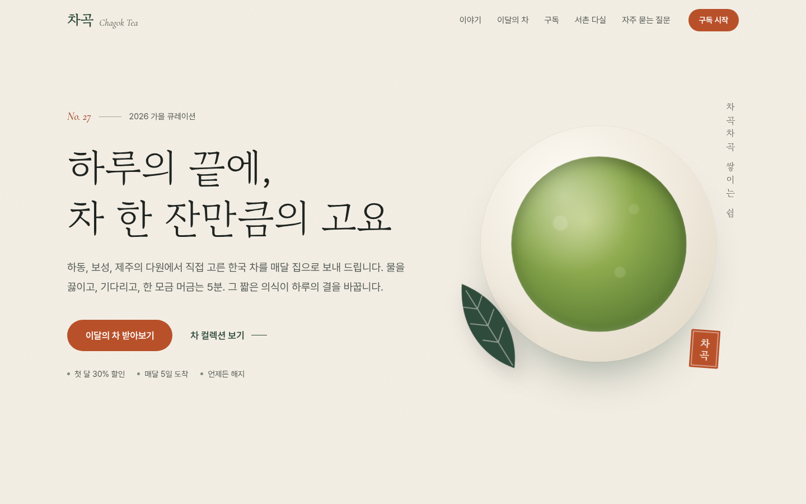
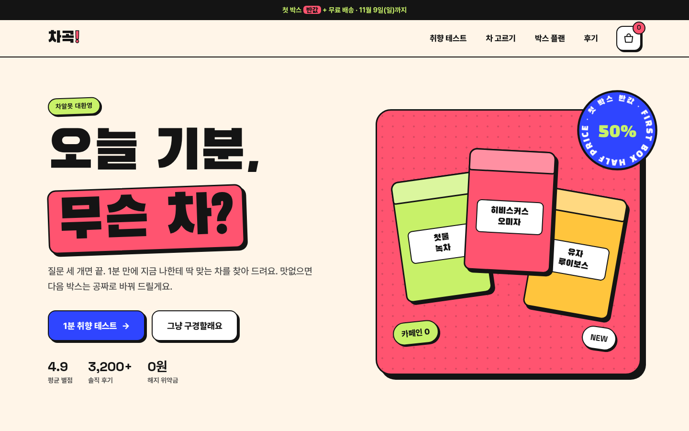
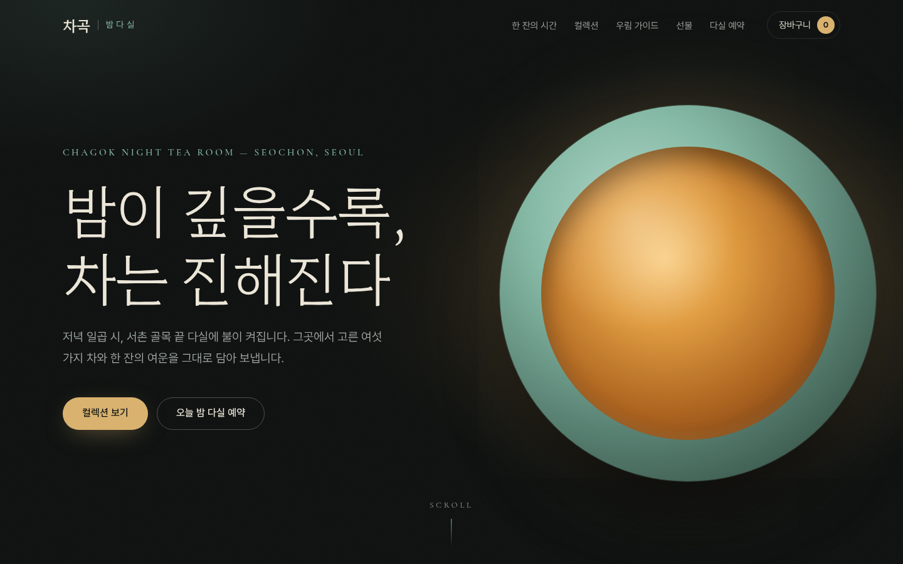

# 차곡 — 좋은 웹사이트 디자인 탐구

가상의 한국 차 브랜드 **차곡(Chagok)** 을 세 가지 디자인 철학으로 만든 웹사이트입니다. 상품과 정보는 같고, 누구에게 무엇을 하게 할지만 다릅니다. 그 차이가 색, 서체, 레이아웃, 인터랙션을 어떻게 바꾸는지 비교하는 것이 목적입니다.

**바로 보기:** [비교 허브](https://smhan-dev.github.io/chagok-web-design/) · [V1 고요](https://smhan-dev.github.io/chagok-web-design/v1-goyo/) · [V2 톡톡](https://smhan-dev.github.io/chagok-web-design/v2-toktok/) · [V3 밤다실](https://smhan-dev.github.io/chagok-web-design/v3-bamdasil/) · [리서치 문서](docs/research.md)

| | V1 고요 | V2 톡톡 | V3 밤다실 |
|---|---|---|---|
| 철학 | Editorial Calm · 덜어내기 | Pop Brutal · 촉감과 놀이 | Noir Premium · 몰입과 여운 |
| 대상 / 목표 | 30–40대 · 월 구독 | 차가 처음인 20대 · 퀴즈 → 첫 박스 | 선물 고객 · 선물 세트, 다실 예약 |
| 바탕 · 키 · 보조 · 포인트 | 한지 `#F4EFE6` · 송엽 `#2F4B3C` · 이끼 세이지 `#A9B59F` · 감 `#B8512A` | 오트밀크 `#FFF5E8` · 히비스커스 `#FF5470` · 말차 라임 `#C8F169` · 코발트 `#2F45FF` | 밤먹 `#0E1110` · 청자 `#8EC5B0` · 심청 `#2C4A40` · 금박 `#D9B26F` |
| 제목 서체 | 고운바탕 | 검은고딕 | 함렛 |

| V1 고요 | V2 톡톡 | V3 밤다실 |
|---|---|---|
|  |  |  |

## 보는 방법

정적 파일만 있으므로 아무 정적 서버로 열면 됩니다.

```bash
cd chagok-web-design
python3 -m http.server 8000
# → http://localhost:8000  (비교 허브)
```

`file://`로 직접 열면 브라우저 보안 정책 때문에 웹폰트가 막힐 수 있습니다.

## 구조

```
chagok-web-design/
├─ index.html, hub.css        비교 허브: 원칙, 버전별 컬러·타이포·UX, 비교표
├─ v1-goyo/                   V1 고요      (index.html · style.css · main.js)
├─ v2-toktok/                 V2 톡톡
├─ v3-bamdasil/               V3 밤다실
├─ assets/fonts/              서브셋 웹폰트(woff2), fonts.css(자동 생성), licenses/
├─ docs/
│  ├─ research.md             리서치 노트: 정의, 색·타이포·UX 법칙·접근성·성능, 출처
│  └─ contrast-report.md      색 대비 검사 결과(자동 생성)
├─ screenshots/               Playwright 캡처 (데스크톱 1440px · 모바일 390px · 인터랙션)
└─ tools/
   ├─ fetch-fonts.sh          폰트 원본(OFL)과 fonttools·brotli 받기
   ├─ subset_fonts.py         페이지에 쓰인 글자만 남겨 woff2 생성 + fonts.css 작성
   └─ contrast.mjs            style.css의 색 토큰을 읽어 WCAG 대비 검사
```

## 도구

```bash
node tools/contrast.mjs         # 대비 검사. 실패가 있으면 종료 코드 1
bash tools/fetch-fonts.sh       # (최초 1회) 폰트 원본과 서브셋 도구 받기
python3 tools/subset_fonts.py   # 문구를 바꾼 뒤 폰트 다시 서브셋
```

문구를 고친 뒤 `subset_fonts.py`를 다시 돌리지 않으면, 새로 추가한 글자는 대체 서체로 보입니다.

## 검증 결과

- 색 대비: 필수 조합 30개 모두 WCAG 2.2 AA 통과 → [docs/contrast-report.md](docs/contrast-report.md)
- Chromium(Playwright) 1440px · 390px: 콘솔 오류 0건, 가로 넘침 0px
- 인터랙션: 필터, 결제 주기 전환, 퀴즈 → 추천 → 담기, 스크롤리텔링, 타이머, 장바구니 dialog(Esc 닫기 후 포커스 복귀), 예약 인원 제한
- 확인하지 못한 것: Safari·Firefox·실기기, 실제 화면 낭독기, 사용자 테스트, 실측 Core Web Vitals

## 라이선스와 고지

- 폰트: Pretendard, 고운바탕, 검은고딕, 함렛, Cormorant Garamond, Space Grotesk — 모두 SIL Open Font License 1.1 (`assets/fonts/licenses/`)
- 브랜드, 인물, 후기, 가격, 주소는 모두 디자인 연구용 가상 데이터입니다.
